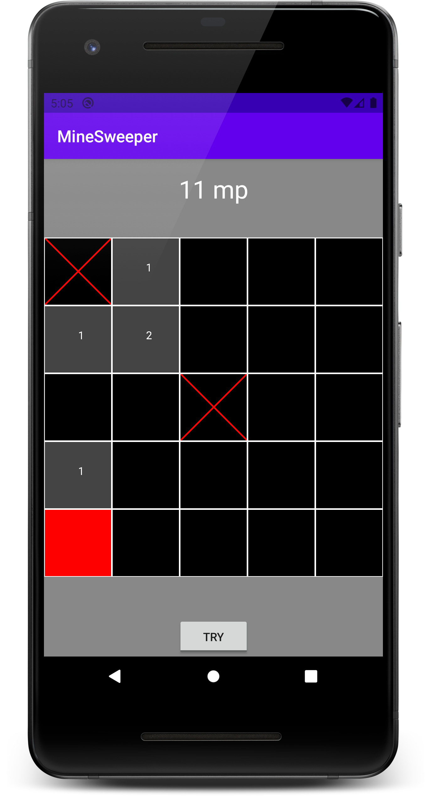

# Android 2

## Aknakereső Android alkalmazás fejlesztése 

## Bevezetés

A labor során Android platformra kell elkészíteni egy Aknakereső játékot Kotlin nyelven:

[http://en.wikipedia.org/wiki/Minesweeper_(video_game)](http://en.wikipedia.org/wiki/Minesweeper_(video_game))



### Szabályok

A labor során az idő rövidsége miatt elegendő, ha az alkalmazás az alábbi megkötésekkel üzemel:

* 5x5 játéktér elég
* 3 akna elég
* nem kell teljes feltöltő logikát írni, elég ha be van égetve egy fix elrendezés
* Működjenek az alábbi funkciók:
    * zászló lehelyezése
    * mező kipróbálása
* Ha a kipróbált mező:
    * akna, a játék véget ér
    * nem akna, akkor megjelenik egy szám, ami a szomszédos aknák számát jelzi

Érdemes először végigolvasni az összes feladatot, hogy aki minden funkciót szeretne megvalósítani, már az elején úgy tervezhessen, és ne közben kelljen módosítani például az adatmodellen.
Az alkalmazás elkészítése során törekedj a strukturált felépítésre, kódszervezésére. Készíts letisztult, ergonomikus felhasználói felületeket, figyelj a vissza gomb megfelelő működésére, továbbá a hibák kezelésére és a felhasználó számára történő releváns visszajelzésekre.


### Értékelés

Az Alapok rész hiánytalan megvalósítása esetén sikeres (elégséges) a labor. Az Alapok részen kívül megoldott minden további részfeladat hiánytalan megvalósítása plusz egy jegyet jelent. A feladatok részben egymásra épülnek, ezért az ebből következő hiányok – feladat kihagyás esetén – szükség szerint áthidalhatók pl. dummy adatok használatával.

Minden egyes fázisról szükséges 

- képernyőképet készíteni, 
- a fejlesztési lépéseket néhány mondatban dokumentálni a `README.md` fájlban.

 Az AI használat megengedett, de ebben az esetben is szükséges a kód működését elmagyarázni, így igazolva a megértést.


## Előkészületek

A feladatok megoldása során ne felejtsd el követni a [feladat beadás folyamatát](../../tudnivalok/github/GitHub.md).

### Git repository létrehozása és letöltése

1. Moodle-ben keresd meg a laborhoz tartozó meghívó URL-jét és annak segítségével hozd létre a saját repository-dat!

1. Várd meg, míg elkészül a repository, majd checkout-old ki!

    !!! warning "Checkout"
        Egyetemi laborokban, ha a checkout során nem kér a rendszer felhasználónevet és jelszót, és nem sikerül a checkout, akkor valószínűleg a gépen korábban megjegyzett felhasználónévvel próbálkozott a rendszer. Először töröld ki a mentett belépési adatokat (lásd [itt](../../tudnivalok/github/GitHub-credentials.md)), és próbáld újra.

1. Hozz létre egy új ágat `megoldas` néven, és ezen az ágon dolgozz!

1. Folyamatosan dokumentáld a haladást a `README.md` fájlban!


### Projekt létrehozása

Első lépésként indítsuk el az Android Studio-t, majd:

1. Hozzunk létre egy új projektet, válasszuk az *Empty Activity* lehetőséget.
1. A projekt neve legyen `MineSweeper`, a kezdő package pedig `hu.bme.aut.klaf.minesweeper`.
1. Nyelvnek válasszuk a *Kotlin*-t.
1. A minimum API szint legyen API26: Android 8.0.
1. A *Build configuration language* Kotlin DSL legyen.

!!!danger "FILE PATH"
	A projekt mindenképpen a repository-ban lévő MineSweeper könyvtárba kerüljön, és beadásnál legyen is felpusholva! A kód nélkül nem tudunk maximális pontot adni a laborra!


## 1. Alapok (2 pont)

!!!warning "Tippek"

	* Törekedj a rövid osztályokra és függvényekre, valamint az átlátható forráskódra!
	* Ügyelj a megfelelően hierarchikus *package* szervezésre, a kódolás során tartsd szem előtt a *Clean Code* elveket!
	* Kezeld megfelelően a készülék elforgatása során bekövetkező életciklus változásokat!
	* Perzisztenciánál figyelj a megfelelő szálkezelésre!
	* A feladat megvalósítása és beadása során önálló, egyedi munkákat várunk!

### Egyedi ikon

Állíts be az alkalmazásnak egyedi vagy saját készítésű ikont.

### Főmenü

Az alkalmazás indulása után egy főmenü jelenjen meg két gombbal: "Új játék" és "Eredmények"

Az "Új játék" gomb megnyomására egy új felületen jelenjen meg a játéktér, amin érintés esemény hatására változnak az egyes mezők. Mivel itt több elem együttes működésére van szükség, a lépéseket és mintakódokat biztosítunk.

### Játék

A játék állapotának nyilvántartásához szükségünk lesz egy mező osztályra az abból képzett 2 dimenziós tömbre, illetve a játéktéren elvégezhető műveletekre. A mező osztályt és a műveleteket (melyeket egy *interface*-ben sorolunk fel, helyezzük a `domain` rétegbe, hiszen ezek alkotják az alkalmazás gerincét:

#### Játék motor

```kotlin
package hu.bme.aut.klaf.minesweeper.domain.model

data class Tile(
    val type: TileType = TileType.FIELD_TYPE_NORMAL,
    val minesAround: Byte = 0 //-1 means mine
) {
    enum class TileType {
        FIELD_TYPE_NORMAL,
        FIELD_TYPE_REVEALED,
        FIELD_TYPE_FLAGGED
    }
}
```

```kotlin
package hu.bme.aut.klaf.minesweeper.domain.repository

import hu.bme.aut.klaf.minesweeper.domain.model.Tile
import kotlinx.coroutines.flow.StateFlow

interface IMineSweeperRepository {
    fun getField(): StateFlow<Array<Array<Tile>>>

    fun flagField(x: Int, y: Int)

    fun unFlagField(x: Int, y: Int)

    fun revealField(x: Int, y: Int)

}
```

A konkrét játéktér összeállítását és a műveletek megvalósítását már az adat réteg tartalmazza:

```kotlin
package hu.bme.aut.klaf.minesweeper.data

import hu.bme.aut.klaf.minesweeper.domain.repository.IMineSweeperRepository
import hu.bme.aut.klaf.minesweeper.domain.model.Tile
import kotlinx.coroutines.flow.MutableStateFlow
import kotlinx.coroutines.flow.StateFlow
import kotlinx.coroutines.flow.asStateFlow

object MineSweeperModel : IMineSweeperRepository {

    private const val BOARD_SIZE = 5

    private val fieldMatrix = MutableStateFlow(
        Array(BOARD_SIZE) { _ -> Array(BOARD_SIZE) { Tile() } }
    )

    init {
        initGameArea()
    }

    fun initGameArea() {
        fieldMatrix.value = arrayOf(
            arrayOf(
                Tile(Tile.TileType.FIELD_TYPE_NORMAL, 1),
                Tile(Tile.TileType.FIELD_TYPE_NORMAL, -1),
                TODO()
            ),
            arrayOf(
                Tile(Tile.TileType.FIELD_TYPE_NORMAL, 1),
                Tile(Tile.TileType.FIELD_TYPE_NORMAL, 1),
                TODO()
            ),
            TODO()
        )
    }

    override fun getField(): StateFlow<Array<Array<Tile>>> =
        fieldMatrix.asStateFlow()

    override fun flagField(x: Int, y: Int) {
        if (fieldMatrix.value[x][y].type != Tile.TileType.FIELD_TYPE_REVEALED)
            modifyFieldType(x, y, Tile.TileType.FIELD_TYPE_FLAGGED)
    }

    override fun unFlagField(x: Int, y: Int) {
        if (fieldMatrix.value[x][y].type != Tile.TileType.FIELD_TYPE_REVEALED)
            modifyFieldType(x, y, Tile.TileType.FIELD_TYPE_NORMAL)
    }

    override fun revealField(x: Int, y: Int) {
        if (fieldMatrix.value[x][y].type != Tile.TileType.FIELD_TYPE_FLAGGED)
            modifyFieldType(x, y, Tile.TileType.FIELD_TYPE_REVEALED)
    }

    private fun modifyFieldType(x: Int, y: Int, t: Tile.TileType) {

        val current = fieldMatrix.value
        val updated = Array(current.size) { i ->
            current[i].clone()
        }
        updated[x][y] = (updated[x][y]).copy(type = t)
        fieldMatrix.value = updated
    }
}
```

Látható, hogy a játéktér állapotát egy `MutableStateFlow`-n kereszül adjuk ki, így helyes használat esetén az állapotok változása azonnal megjelenik a UI-en.


#### Játék felület

A képernyőn való megjelenítést egy saját *@Composable*-ben fogjuk megvalósítani:

```kotlin
package hu.bme.aut.klaf.minesweeper.ui.screen.game

import androidx.compose.foundation.Canvas
import androidx.compose.foundation.gestures.detectTapGestures
import androidx.compose.foundation.layout.BoxWithConstraints
import androidx.compose.foundation.layout.aspectRatio
import androidx.compose.foundation.layout.size
import androidx.compose.runtime.Composable
import androidx.compose.runtime.collectAsState
import androidx.compose.runtime.getValue
import androidx.compose.ui.Modifier
import androidx.compose.ui.geometry.Offset
import androidx.compose.ui.graphics.Color
import androidx.compose.ui.graphics.StrokeCap
import androidx.compose.ui.graphics.drawscope.DrawScope
import androidx.compose.ui.graphics.drawscope.Stroke
import androidx.compose.ui.input.pointer.pointerInput
import androidx.compose.ui.unit.dp
import hu.bme.aut.klaf.minesweeper.data.MineSweeperModel
import hu.bme.aut.klaf.minesweeper.domain.model.Tile

@Composable
fun GameArea(modifier: Modifier = Modifier) {
    val fieldMatrix by MineSweeperModel.getField().collectAsState()

    BoxWithConstraints {
        val minSize = minOf(maxWidth, maxHeight)
        Canvas(
            modifier = modifier
                .size(minSize)
                .aspectRatio(1f)
                .pointerInput(Unit) {
                    detectTapGestures(
                        onLongPress = { offset ->
                            val cellWidth = size.width / 5f
                            val cellHeight = size.height / 5f
                            val tX = (offset.x / cellWidth).toInt()
                            val tY = (offset.y / cellHeight).toInt()

                            if (tX in 0..4 && tY in 0..4) {
                                val tile = fieldMatrix[tX][tY]
                                when (tile.type) {
                                    Tile.TileType.FIELD_TYPE_NORMAL ->
                                        MineSweeperModel.flagField(
                                            tX,
                                            tY
                                        )

                                    Tile.TileType.FIELD_TYPE_FLAGGED ->
                                        MineSweeperModel.unFlagField(
                                            tX,
                                            tY
                                        )

                                    Tile.TileType.FIELD_TYPE_REVEALED -> {}
                                }
                            }
                        },
                        onTap = { offset ->
                            TODO()
                        }
                    )
                }
        ) {
            val widthFloat = size.width
            val heightFloat = size.height
            val cellWidth = widthFloat / 5f
            val cellHeight = heightFloat / 5f


            // 1. Háttér rajzolása
            drawRect(
                color = Color.Black,
                size = size
            )

            // 2. Játékállapot rajzolása
            for (i in 0 until 5) {
                for (j in 0 until 5) {
                    val tile = fieldMatrix[i][j]
                    val startX = i * cellWidth
                    val startY = j * cellHeight
                    val endX = (i + 1) * cellWidth
                    val endY = (j + 1) * cellHeight
                    when (tile.type) {
                        Tile.TileType.FIELD_TYPE_FLAGGED ->
                            drawFlag(startX, startY, endX, endY)

                        Tile.TileType.FIELD_TYPE_REVEALED -> TODO()

                        Tile.TileType.FIELD_TYPE_NORMAL -> {}
                    }
                }
            }

            //3. Játéktér rajzolása
            val strokeWidth = 5.dp.toPx()
            val lineColor = Color.White

            drawRect(
                color = lineColor,
                size = size,
                style = Stroke(width = strokeWidth)
            )

            for (i in 1..4) {
                val y = i * cellHeight
                drawLine(
                    color = lineColor,
                    start = Offset(0f, y),
                    end = Offset(widthFloat, y),
                    strokeWidth = strokeWidth
                )
            }

            for (i in 1..4) {
                val x = i * cellWidth
                drawLine(
                    color = lineColor,
                    start = Offset(x, 0f),
                    end = Offset(x, heightFloat),
                    strokeWidth = strokeWidth
                )
            }
        }
    }
}

private fun DrawScope.drawFlag(
    startX: Float,
    startY: Float,
    endX: Float,
    endY: Float,
) {
    drawLine(
        color = Color.Red,
        start = Offset(startX, startY),
        end = Offset(endX, endY),
        strokeWidth = 5.dp.toPx(),
        cap = StrokeCap.Round
    )

    drawLine(
        color = Color.Red,
        start = Offset(endX, startY),
        end = Offset(startX, endY),
        strokeWidth = 5.dp.toPx(),
        cap = StrokeCap.Round
    )
}

private fun DrawScope.drawField(
    startX: Float,
    startY: Float,
    endX: Float,
    endY: Float,
    n: Byte
) {
    TODO()
}
```

Itt 

- *val fieldMatrix by MineSweeperModel.getField().collectAsState()*: egy `Canvas`-re rajzoljuk a `fieldMatrix`-unk állapotát, amelyet a modeltől szerzünk
- *.fillMaxWidth()*: teljes szélességre rajzolunk,
- *.aspectRatio(1f)*:  1:1 aránnyal,
- *.pointerInput(Unit)*: kezeljük a hosszú érintéseket, 

Majd pedig kirajzoljuk a 

- hátteret
- a játékállapotot
- a játékteret

A `GameArea`-t ez után ágyazzuk be egy `GameScreen`-be, és már meg is tudjuk jeleníteni:

```kotlin
package hu.bme.aut.klaf.minesweeper.ui.screen.game

import androidx.compose.foundation.layout.Box
import androidx.compose.foundation.layout.fillMaxSize
import androidx.compose.foundation.layout.padding
import androidx.compose.material.icons.Icons
import androidx.compose.material.icons.automirrored.filled.ArrowBack
import androidx.compose.material3.ExperimentalMaterial3Api
import androidx.compose.material3.Icon
import androidx.compose.material3.IconButton
import androidx.compose.material3.Scaffold
import androidx.compose.material3.Text
import androidx.compose.material3.TopAppBar
import androidx.compose.runtime.Composable
import androidx.compose.runtime.LaunchedEffect
import androidx.compose.ui.Alignment
import androidx.compose.ui.Modifier
import androidx.compose.ui.unit.dp
import hu.bme.aut.klaf.minesweeper.data.MineSweeperModel

@OptIn(ExperimentalMaterial3Api::class)
@Composable
fun GameScreen(
    onBack: () -> Unit,
    modifier: Modifier = Modifier
) {
    LaunchedEffect(key1 = Unit) {
        MineSweeperModel.initGameArea()
    }
    Scaffold(
        modifier = modifier.fillMaxSize(),
        topBar = {
            TopAppBar(
                title = { Text("Játék") },
                navigationIcon = {
                    IconButton(onClick = onBack) {
                        Icon(
                            imageVector = Icons.AutoMirrored.Filled.ArrowBack,
                            contentDescription = "Vissza"
                        )
                    }
                }
            )
        }
    ) { innerPadding ->
        Box(
            modifier = Modifier
                .fillMaxSize()
                .padding(innerPadding)
                .padding(16.dp),
            contentAlignment = Alignment.Center
        ) {
            GameArea()
        }
    }
}
```

!!! example "BEADANDÓ (2 pont)"
	Ebben a fázisban az alkalmazásnak képesnek kell lennie az érintés eseményre reagálni. Vagyis: Egy mezőhöz való hozzáérésnél valamilyen változást kell látnunk a játéktéren. (Pl. zászló megjelenítése)

    Készíts egy **képernyőképet**, amelyen látszik a **futó alkalmazás** és **egy hozzá tartozó kódrészlet**. 

	A képet a megoldásban a repository-ba f1.png néven töltsd föl.
    
    Dokumentáld a folyamatot a `Readme.md` fájlban!


## 2. Bombák, zászlók, számok megjelenítése (1 pont)

Ha már a játéktér megjelenik a felületen és össze van kötve a modellel, készítsd el és tedd használhatóvá a játék különbözö elemeit (grafikusan mindegyik máshogy jelenjen meg):

* A megérintett mező színe változzon meg, hogy egyértelmű legyen, hogy az már fel van fedve.
* Ha a megérintett mező alatt bomba van, az legyen egyértelműen jelezve.
* Ha a megérintett mező alatt szám van, az jelenjen meg.
* Legyen lehetőség zászlók letételére és felvételére még nem megnézett mezőn. (Ez bármilyen módszerrel történhet, pl. rövid és hosszú érintés.)

!!! example "BEADANDÓ (1 pont)"
    Készíts egy **képernyőképet**, amelyen látszik a **futó alkalmazás a feladatnak megfelelő állapotban** és **egy hozzá tartozó kódrészlet**. 
    
	A képet a megoldásban a repository-ba f2.png néven töltsd föl.

    Dokumentáld a folyamatot a `Readme.md` fájlban!


## 3. Játék vége és időmérés (1 pont)

A felületre helyezz el egy futó órát, ami a megoldás idejét számolja.
Készítsd el a játék befejezésének logikáját immár ViewModel és MVI architektúra használatával. A játék befejezését jelezze dialógusablak:
    
* Ha egy bomba felfedésre kerül, a játék vereséggel véget ér.
* Ha a bombák kivételével az összes mező felfedésre került, a játék győzelemmel ér véget. Ekkor a dialógusablakban jelenjen meg a felhasznált idő is.

!!! example "BEADANDÓ (1 pont)"
    Készíts egy **képernyőképet**, amelyen látszik a **futó alkalmazás az órával** és **egy hozzá tartozó kódrészlet**. 

	A képet a megoldásban a repository-ba f3.png néven töltsd föl.
    
    Dokumentáld a folyamatot a `Readme.md` fájlban!


## 4. Perzisztencia (1 pont)

Ha a játék győzelemmel ér véget, kérjen be egy felhasználónevet, és ezt az idővel együtt mentse el perzisztensen.

Valósítsd meg az "Eredmények" gomb funkcionalitását! Nyíljon meg egy új felület, amin egy listában láthatóak a nevek és az elért időeredmények.

!!! example "BEADANDÓ (1 pont)"
    Készíts egy **képernyőképet**, amelyen látszik a **futó alkalmazás a játék vége dialógussal** és **egy hozzá tartozó kódrészlet**. 

	A képet a megoldásban a repository-ba f4.png néven töltsd föl.
    
    Dokumentáld a folyamatot a `Readme.md` fájlban!
