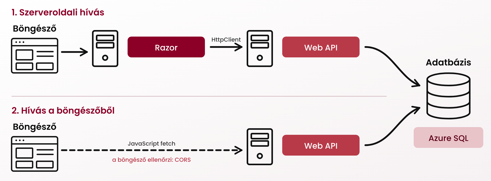

# Bónusz feladat: A Razor alkalmazás és a Web API összekötése

Eddig mindkét alkalmazás közvetlenül az adatbázisból dolgozott. Most a Razor alkalmazás egy új oldala HTTP-n keresztül, a Web API-tól kéri le az adatokat. Ez a felállás tipikus, ha egy frontend több háttérszolgáltatásból dolgozik. A hívást kétféleképpen is elvégzed:



A második esetben egy új jelenséggel, a *CORS*-szal is találkozol. A Razor alkalmazás többi oldala változatlanul az adatbázist használja, csak az új oldal dolgozik a Web API-ból.

!!! note "Eltérés a Razor labor szabályaitól"
    A Razor laboron a `PageModel` csak az `IMovieCatalogDataService`-t használhatta. Az ebben a bónusz feladatban készülő oldal kivétel: ez a lent elkészített `GenreApiClient`-et használja.

## 1. A Web API címe a konfigurációból

A Razor alkalmazásnak tudnia kell, hol éri el a Web API-t. Ez környezetenként más (helyben `localhost`, Azure-ban az `azurewebsites.net`-es cím), ezért konfigurációba kerül, nem a kódba.

1. A `MovieCatalog.Web` projekt `appsettings.Development.json` fájljába vedd fel a helyben futó Web API címét (a portot a `MovieCatalog.Api` projekt `Properties/launchSettings.json` fájljában találod):

    ``` JSON
    {
        "MovieCatalogApi": {
            "BaseUrl": "http://localhost:<port>/"
        }
    }
    ```

1. Azure-ban a Razor Web App oldalán: *Settings* » *Environment variables* » *App settings* fül » *Add*:
    - *Name*: `MovieCatalogApi__BaseUrl`
    - *Value*: `https://<a Web API default domainje>/`

    Majd *Apply* és *Apply*.

!!! info "Miért dupla aláhúzás?"
    Linuxon a környezeti változók neve nem tartalmazhat kettőspontot. Az ASP.NET Core ezért a `__` (dupla aláhúzás) jelet a konfigurációs szakaszok elválasztójaként értelmezi: a `MovieCatalogApi__BaseUrl` környezeti változó a kódban `MovieCatalogApi:BaseUrl` kulcsként látszik.

!!! warning "Perjel a cím végén"
    A `BaseUrl` értéke `/` jelre végződjön, a relatív hívási útvonal (`api/genres`) pedig ne `/` jellel kezdődjön. Ellenkező esetben a `HttpClient` a cím egy részét elhagyhatja.

## 2. Típusos HttpClient

1. Hozd létre a `Services/GenreApiClient.cs` fájlt:

    ``` C#
    using System.Net.Http.Json;

    namespace MovieCatalog.Web.Services;

    public record GenreDto(int Id, string Name);

    public class GenreApiClient(HttpClient httpClient)
    {
        public async Task<IReadOnlyList<GenreDto>> GetGenresAsync(CancellationToken cancellationToken = default)
            => await httpClient.GetFromJsonAsync<List<GenreDto>>("api/genres", cancellationToken) ?? [];
    }
    ```

    - A `GetFromJsonAsync` a JSON választ a `GenreDto` típusra alakítja. A webes alapbeállítások miatt a kis- és nagybetű nem számít (`id` » `Id`), a válasz további mezőit pedig figyelmen kívül hagyja.
    - Ha a projekted névtere eltér, értelemszerűen javítsd.

1. Regisztráld a *Program.cs*-ben:

    ``` C#
    builder.Services.AddHttpClient<GenreApiClient>(client =>
    {
        var baseUrl = builder.Configuration["MovieCatalogApi:BaseUrl"]
            ?? throw new InvalidOperationException("A MovieCatalogApi:BaseUrl beállítás hiányzik.");
        client.BaseAddress = new Uri(baseUrl);
    });
    ```

    Az `AddHttpClient` a `HttpClient` példányokat a keretrendszerrel kezelteti. Ha minden kéréshez `new HttpClient()` készülne, nagy terhelésnél elfogyhatnának a hálózati kapcsolatok (*socket exhaustion*).

## 3. Műfajok weboldal, szerveroldali hívással

Készíts egy új Razor Page-et `ApiGenres` néven (`Pages/ApiGenres.cshtml`), amely:

- a címében tartalmazza a Neptun kódodat (pl. *Műfajok a Web API-ból – ABC123*),
- a `GenreApiClient` segítségével lekéri a műfajokat, és ABC sorrendben listázza őket (a rendezés történhet memóriában),
- kiírja, hány műfajt kapott,
- ha a Web API nem érhető el (`HttpRequestException`, időtúllépés), nem 500-as hibaoldalt mutat, hanem egy barátságosabb hibaüzenetet, és a hibát naplózza (`ILogger`).

Vegyél fel az oldalra mutató menüpontot is a `_Layout.cshtml` menüsorába *Műfajok (API)* felirattal.

Próbáld ki helyben (Visual Studióban mindkét projektet indítsd el: solutionön jobb klikk » *Configure Startup Projects* » *Multiple startup projects*), majd telepítsd az Azure-ba. Ha elkészült a 3. és a 4. feladat, ehhez elég a push.

!!! tip "Tippek"
    - Az `OnGetAsync`-ban a kérés megszakítását jelző tokent a `HttpContext.RequestAborted` adja, ezt add tovább a `GetGenresAsync`-nak.
    - A hibakezelés kipróbálásához helyben állítsd le a Web API-t, és frissítsd az oldalt.
    - Free F1 csomagon mindkét alkalmazás elalhat. Ha a Razor alkalmazás egy alvó Web API-t hív, az első kérés két *cold start* miatt is lassú lehet.

## 4. Hívás a böngészőből: CORS

1. Tedd elérhetővé az oldal számára a Web API címét: a `PageModel` kapjon konstruktoron keresztül egy `IConfiguration` példányt, és tegye ki a `MovieCatalogApi:BaseUrl` értékét egy `public string ApiBaseUrl { get; private set; }` tulajdonságba.
1. Egészítsd ki az oldalt egy gombbal, amely a böngészőből, JavaScripttel kéri le ugyanezt a listát:

    ``` HTML
    <h3>Betöltés a böngészőből</h3>
    <button id="loadGenres" class="btn btn-secondary">Műfajok betöltése (fetch)</button>
    <ul id="clientGenres"></ul>

    @section Scripts {
        <script>
            document.getElementById('loadGenres').addEventListener('click', async () => {
                const list = document.getElementById('clientGenres');
                list.innerHTML = '';
                try {
                    const response = await fetch('@Model.ApiBaseUrl' + 'api/genres');
                    const genres = await response.json();
                    for (const genre of genres) {
                        const item = document.createElement('li');
                        item.textContent = genre.name;
                        list.appendChild(item);
                    }
                } catch (error) {
                    list.textContent = 'Hiba: ' + error;
                    console.error(error);
                }
            });
        </script>
    }
    ```

1. Telepítsd, nyisd meg az oldalt az Azure-ban, nyisd meg a fejlesztői eszközöket (++f12++, *Console* fül), és kattints a gombra. Egy ehhez hasonló hibát kapsz:

    ```text
    Access to fetch at 'https://mc-api-....azurewebsites.net/api/genres' from origin
    'https://mc-web-....azurewebsites.net' has been blocked by CORS policy:
    No 'Access-Control-Allow-Origin' header is present on the requested resource.
    ```

    !!! info "Miért működött szerveroldalon, és miért nem a böngészőből?"
        A böngésző az ún. *same-origin policy* szerint alapértelmezetten nem engedi, hogy egy oldal JavaScript kódja más originről (séma + host + port) származó választ olvasson. A Razor oldal a `mc-web-...` originről jön, a Web API a `mc-api-...` originen fut, tehát a kettő különböző. A kérés eljut a szerverig, a szerver válaszol is, de a böngésző nem adja oda a választ a JavaScriptnek, hacsak a szerver egy `Access-Control-Allow-Origin` fejléccel kifejezetten nem engedélyezi.

        A szerveroldali `HttpClient` hívásnál nincs böngésző a láncban, ezért ott CORS sem létezik.

1. Engedélyezd a Razor alkalmazás originjét a Web API-ban. A *Program.cs*-ben:

    ``` C#
    // a builder.Build() előtt
    builder.Services.AddCors(options =>
        options.AddPolicy("MovieCatalogWeb", policy => policy
            .WithOrigins(builder.Configuration.GetSection("Cors:AllowedOrigins").Get<string[]>() ?? [])
            .WithMethods("GET")
            .AllowAnyHeader()));

    // a builder.Build() után, a MapControllers() előtt
    app.UseCors("MovieCatalogWeb");
    ```

    Az engedélyezett originek konfigurációból jönnek:

    - Helyben, a Web API `appsettings.Development.json` fájljában: `"Cors": { "AllowedOrigins": [ "http://localhost:<a Razor alkalmazás portja>" ] }`
    - Azure-ban, a Web API *App settings* beállításai között: *Name*: `Cors__AllowedOrigins__0`, *Value*: `https://<a Razor alkalmazás default domainje>`

    !!! warning "Az origin pontos formája"
        Az origin csak séma + host (+ port), perjel és útvonal nélkül: `https://mc-web-xxx.azurewebsites.net`, és nem `https://mc-web-xxx.azurewebsites.net/`. Egyetlen záró perjel miatt is elutasított lesz a kérés.

    !!! warning "CORS beállítása: vagy a kódban, vagy a portálon"
        Az App Service-nek van saját CORS beállítása is (*API* » *CORS*). Ha azt bekapcsolod, a platform kezeli a CORS-t, és a kódban lévő beállításod hatástalanná válik. Ebben a feladatban a kódbeli megoldást használd, a portálon ne állíts be semmit. A „gyors megoldásként” használt `AllowAnyOrigin()` sem elfogadható.

1. Telepítsd újra a Web API-t, és próbáld újra a gombot. A lista megtelik, és a fejlesztői eszközök *Network* fülén az `api/genres` kérés válaszfejlécei között ott van az `Access-Control-Allow-Origin`.

## 5. A CORS korlátai

A CORS a böngészőben futó oldalak felhasználóit védi, nem az API-t. Próbáld ki PowerShellben (Windows PowerShellben a `curl` az `Invoke-WebRequest` álneve, ezért `curl.exe` kell):

```powershell
curl.exe -i https://<a Web API default domainje>/api/genres
curl.exe -i -H "Origin: https://example.com" https://<a Web API default domainje>/api/genres
```

Mindkét esetben megkapod az adatokat, a második esetben csak az `Access-Control-Allow-Origin` fejléc hiányzik a válaszból.

## Beadandó

| Kép tartalma | Fájlnév (kiterjesztés nélkül) |
|--------------|-------------------------------|
| Az *ApiGenres* oldal az Azure-ban, a szerveroldalon lekért műfajlistával | `fb_server` |
| A CORS hiba a fejlesztői eszközök *Console* fülén, a CORS engedélyezése előtt | `fb_cors_error` |
| A böngészőből sikeresen betöltött lista, és a *Network* fülön az `Access-Control-Allow-Origin` válaszfejléc | `fb_cors_ok` |
| A két `curl.exe` parancs kimenete | `fb_curl` |

# Végeztél

Végeztél a bónusz feladattal is. Ha nem tartod meg az erőforrásokat, a beadás után törölheted az `rg-<neptun>` erőforráscsoportot. Ez minden benne lévő erőforrást töröl.
