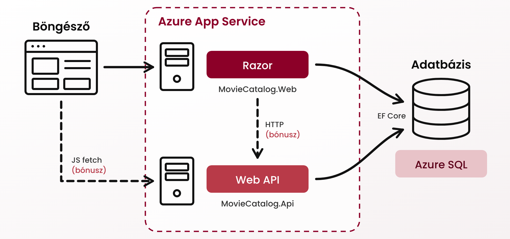

# Áttekintés

A labor során a [Razor](../razor) és a [Web API](../webapi) laboron elkészített alkalmazásaidat telepíted a Microsoft Azure felhőbe.

A labor végére az alábbi architektúra áll össze:

A labor négy, egymásra épülő feladatból és egy bónusz feladatból áll:

1. [A Razor alkalmazás](Feladat-1.md): Azure SQL adatbázis és App Service létrehozása, a Razor alkalmazás kézi telepítése parancssorból.
1. [A Web API](Feladat-2.md): a Web API telepítése ugyanarra az App Service csomagra és adatbázisra.
1. [CI/CD a Razor alkalmazáshoz](Feladat-3.md): minden push automatikusan buildeli és telepíti a Razor alkalmazást, tárolt jelszó vagy titok nélkül.
1. [CI/CD a Web API-hoz](Feladat-4.md): ugyanez a Web API-hoz, végül a Swagger felület bekapcsolása az Azure-ban.
1. [Bónusz: a Razor alkalmazás a Web API-t használja](Bonusz.md): HTTP-hívás szerveroldalról és a böngészőből, a CORS működésének megismerése.

## Előfeltételek, felkészülés

A labor elvégzéséhez szükséges eszközök:

- Az [Entity Framework laborhoz](../ef) használt eszközök (Visual Studio 2026, .NET SDK).
- A [Razor](../razor) és a [Web API](../webapi) laboron elkészült projektjeid (`MovieCatalog.Web`, `MovieCatalog.Api`). Nem kell, hogy minden feladatrészük kész legyen, de fussanak: a Razor alkalmazás főoldala és a Web API egyik, pl. `GET /api/genres` művelete működjön.
- [Azure CLI](https://learn.microsoft.com/en-us/cli/azure/install-azure-cli) (ajánlott). Ellenőrzés: `az version`. Ha nem tudod telepíteni, a telepítés Visual Studióból is elvégezhető (lásd a feladatokban).
- GitHub fiók.

!!! warning "Az Azure-előfizetés aktiválása"
    
    1. Aktiváld az [Azure for Students](https://azure.microsoft.com/en-us/free/students/) előfizetést. Bankkártya nem szükséges. Az aktiváláshoz az *edu.bme.hu*-s fiókodat érdemes használni.
    1. Lépj be az [Azure portálra](https://portal.azure.com), és ellenőrizd, hogy a *Subscriptions* alatt megjelenik az *Azure for Students* előfizetés.
    1. Nézd meg, mely régiókban hozhatsz létre erőforrást. A hallgatói előfizetések csak néhány, előfizetésenként eltérő régiót engedélyeznek. A portál keresőjébe írd be: *Policy*, majd *Authoring* » *Assignments* » *Allowed resource deployment regions* » *Parameters*. Az *Allowed locations* listából válassz ki egy régiót, írd fel, és a labor során végig azt használd.

    Az előfizetés egy évre szól, és megújítható. 10-11 hónap után nyílik meg a megújítási időablak. Ha ezt elmulasztod, egy több hónapos inaktív időszak után igényelhetsz csak új előfizetést.

### Felhőszolgáltatás árazása

A labor kizárólag ingyenes szolgáltatásszinteket használ:

- Azure SQL Database, ingyenes ajánlat (*free offer*): adatbázisonként havi 100 000 vCore-másodperc számítási kapacitás és 32 GB tárhely.
- App Service, Free F1 csomag: legfeljebb 10 alkalmazás, alkalmazásonként napi 60 CPU-perc.

Ahhoz, hogy valóban ne fogyjon a kredited:

- App Service csomagnál mindig a Free F1 szintet válaszd.
- Az SQL adatbázisnál mindig az ingyenes ajánlatot (*Free offer*) válaszd.
- Ne hozz létre olyan erőforrást, amit a leírás nem kér (pl. Application Insights, privát végpont).

A labor után az erőforráscsoport törölhető. Megtartva sem fogyaszt kreditet, de ezt érdemes a portálon a *Cost Management* oldalon ellenőrizni.

## Labor menete

### Git repository létrehozása és letöltése

1. Moodle-ben keresd meg a laborhoz tartozó meghívó URL-jét és annak segítségével hozd létre a saját repository-dat.

1. Várd meg, míg elkészül a repository, majd klónozd le.

    !!! warning "Checkout"
        Egyetemi laborokban, ha a checkout során nem kér a rendszer felhasználónevet és jelszót, és nem sikerül a checkout, akkor valószínűleg a gépen korábban megjegyzett felhasználónévvel próbálkozott a rendszer. Először töröld ki a mentett belépési adatokat (lásd [itt](../../tudnivalok/github/GitHub-credentials.md)), és próbáld újra.

1. Hozz létre egy új ágat `megoldas` néven, és ezen az ágon dolgozz.

1. A `neptun.txt` fájlba írd bele a Neptun kódodat. A fájlban semmi más ne szerepeljen, csak egyetlen sorban a Neptun kód 6 karaktere.

1. Másold a repository gyökerébe a Razor laborban elkészült `MovieCatalog.Web` és a Web API laborban elkészült `MovieCatalog.Api` projektmappát (a `bin` és `obj` mappák nélkül).

    - Ellenőrizd, hogy a `.gitignore` tartalmazza a `bin`, `obj`, valamint a labor során készülő `publish` mappát.
    - Kényelmi okokból létrehozhatsz egy közös solutiont is: `dotnet new sln -n MovieCatalog`, majd `dotnet sln add MovieCatalog.Web MovieCatalog.Api`.

### Általános szabályok

- Az Azure-erőforrások nevében szerepeljen a Neptun kódod kisbetűvel (több erőforrástípus nevében nem lehet nagybetű). A leírásban az alábbi neveket használjuk, a `<neptun>` helyére mindenhol a saját kódodat írd:

    | Erőforrás | Név |
    |-----------|-----|
    | Erőforráscsoport (resource group) | `rg-<neptun>` |
    | Logikai SQL szerver | `sql-<neptun>` |
    | SQL adatbázis | `moviecatalog` |
    | App Service csomag (plan) | `plan-<neptun>` |
    | Razor alkalmazás (Web App) | `mc-web-<neptun>` |
    | Web API (Web App) | `mc-api-<neptun>` |
    | Felügyelt identitás a CI/CD-hez | `id-github-<neptun>` |

- Minden erőforrást ugyanabban (az előfizetésed által engedélyezett) régióban hozz létre.
- Jelszó, connection string nem kerülhet a git repository-ba, akkor sem, ha a repository privát. Helyben a *user secrets*, Azure-ban az App Service beállításai tárolják ezeket.

### Beadandó

- A forráskód a repository-ban (a `megoldas` ágon), a beadás a [szokásos módon](../../tudnivalok/github/GitHub.md), pull requesttel történik.
- A feladatoknál felsorolt képernyőképek *png* formátumban, a repository gyökerében, a megadott fájlnévvel.

Képernyőképekkel kapcsolatos elvárások:

- A böngészőablak teljes méretű (maximalizált) legyen, látszódjon a címsor és a weboldal megjelenő része.
- Az Azure portálon látszódjon a jobb felső sarokban a bejelentkezett felhasználó.
- Terminál kimeneténél látszódjon a futtatott parancs és alatta a kimenet. Ha a kimenet nem fér ki, görgess úgy, hogy a parancs a képernyő tetején legyen.

### Értékelés

Minden elkészült feladat egy jegyet ér. A feladatok egymásra épülnek, ezért sorrendben érdemes elkészíteni őket.

| Teljesítés | Jegy |
|------------|------|
| 1. feladat: a Razor alkalmazás fut Azure-ban, és az Azure SQL adatbázisból dolgozik | 2 |
| + 2. feladat: a Web API is fut Azure-ban | 3 |
| + 3. feladat: CI/CD a Razor alkalmazáshoz | 4 |
| + 4. feladat: CI/CD a Web API-hoz, Swagger az Azure-ban | 5 |

A bónusz feladat egy hiányzó feladatot pótolhat (ötösnél jobb jegy nem adható).

A laboron be nem fejezett feladatok otthon, a beadási határidőig befejezhetők.

A feladatok megoldásának akár részleges közzétételéért vagy másolásáért vagy a gyanú felmerülése esetén az aktuális szabályzatok értelmében fegyelmi eljárást indítunk, amelynek eredményeképp a hallgató eltiltásban részesülhet! A feladatok megoldása minden esetben teljesen **önálló**.

## Feladatok

Összesen 4 feladat és egy bónusz feladat van. [Itt kezdd](Feladat-1.md) az első feladattal!
